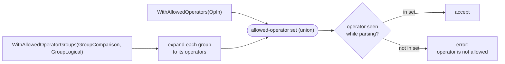
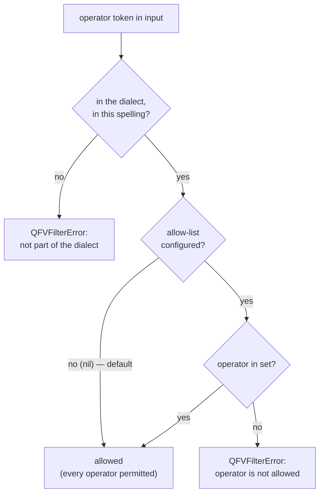
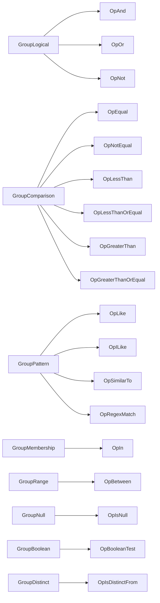
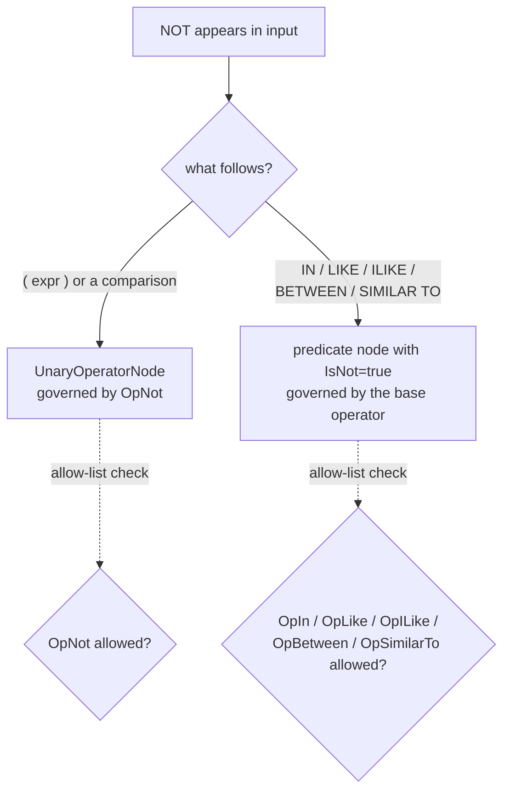

# Configuration

By default the filter parser reads PostgreSQL 18's grammar and accepts every
operator, and the sort parser accepts both `ASC` and `DESC`. You can choose
the SQL dialect, and narrow either, with functional options at construction
time.

## The SQL dialect

A filter is checked in the grammar of the SQL it will run as: the parser
checks an expression, it does not translate one, so what it accepts has to
be what the database runs. `WithDialect` chooses it.

| Dialect | Reference | What it accepts |
| --- | --- | --- |
| `DialectPostgreSQL` (the default) | PostgreSQL 18, and its manual's [SQL Syntax](https://www.postgresql.org/docs/18/sql-syntax.html) chapter | every operator this package knows |
| `DialectSQLStandard` | ISO/IEC 9075:2023 (SQL:2023), Part 2, as PostgreSQL's [SQL Conformance](https://www.postgresql.org/docs/18/features-sql-standard.html) appendix names its features | PostgreSQL's grammar without what PostgreSQL's manual calls its own |

```go
p := qfv.NewFilterParser(fields, qfv.WithDialect(qfv.DialectSQLStandard))

p.Parse("id <> 1 AND name LIKE 'x!%' ESCAPE '!'") // ok
p.Parse("id != 1")                                // error: != is not part of the SQL:2023 dialect: write <>
p.Parse("name ILIKE 'x%'")                        // error: operator "ILIKE" is not part of the SQL:2023 dialect
```

What the SQL standard dialect refuses, and what the standard writes instead:

| PostgreSQL's | The standard's | Why |
| --- | --- | --- |
| `!=` | `<>` | "`<>` is the standard SQL notation for not equal" |
| `ILIKE`, `NOT ILIKE`, `~~*`, `!~~*` | — | "not in the SQL standard but is a PostgreSQL extension" |
| `~~`, `!~~` | `LIKE`, `NOT LIKE` | "PostgreSQL-specific" |
| `~`, `~*`, `!~`, `!~*` | `LIKE_REGEX` (not parsed by this package) | the standard's regular expressions are XQuery's |
| `ISNULL`, `NOTNULL` | `IS NULL`, `IS NOT NULL` | "nonstandard syntax" |
| `ESCAPE ''` | one character | "a zero-length `ESCAPE` value is disallowed" |

What it keeps, each with the standard's feature: the comparison predicate
(E061-01), `BETWEEN` (E061-02) and its `SYMMETRIC` form (T461), `IN` with a
list of values (E061-03), `LIKE` (E061-04) and its `ESCAPE` clause (E061-05),
the NULL predicate (E061-06), `SIMILAR TO` (T141), `IS [NOT] DISTINCT FROM`
(T151, T152), the truth value tests `IS [NOT] TRUE/FALSE/UNKNOWN` (F571), and
`AND`, `OR`, `NOT`.

One difference cannot be checked: without an `ESCAPE` clause the standard has
no escape character, where PostgreSQL's is the backslash, so a pattern with a
backslash in it means one thing to each.

The dialect comes before the allow-list: an operator the dialect does not have
is refused whether `WithAllowedOperators` allows it or not.

A dialect is a value of the `Dialect` type, and the zero value is
`DialectPostgreSQL`; there is no way to name one that does not exist. Each
names its version: `String()` is `PostgreSQL 18` or `SQL:2023`.
Another database's grammar (MySQL's, for instance: `REGEXP`, `<=>`,
backslash escapes in strings) is a dialect to add, with its own tests run
against that database.

## Restricting filter operators

Pass `WithAllowedOperators` and/or `WithAllowedOperatorGroups` to
`NewFilterParser`. Anything outside the allow-list is reported as a validation
error (`operator "LIKE" is not allowed`). When neither option is used, all
operators are allowed.

```go
p := qfv.NewFilterParser(fields,
    qfv.WithAllowedOperatorGroups(qfv.GroupComparison, qfv.GroupLogical),
    qfv.WithAllowedOperators(qfv.OpIn),
)

p.Parse("age >= 18 AND status IN ('active')") // ok
p.Parse("name LIKE '%x%'")                     // error: operator "LIKE" is not allowed
```

The two options are **additive** — groups expand to their operators and merge
with any individually listed operators.



### How gating decides

Every operator the parser encounters is checked against the dialect, and then
against the allowed set. A **nil** set (neither option supplied) is the
default and permits everything the dialect has.



### Operators

| Operator | Matches |
| --- | --- |
| `OpAnd`, `OpOr`, `OpNot` | `AND`, `OR`, standalone `NOT` |
| `OpEqual`, `OpNotEqual` | `=`; `<>` and `!=` |
| `OpLessThan`, `OpLessThanOrEqual` | `<`, `<=` |
| `OpGreaterThan`, `OpGreaterThanOrEqual` | `>`, `>=` |
| `OpLike` | `LIKE`, `NOT LIKE`, `~~`, `!~~` |
| `OpILike` | `ILIKE`, `NOT ILIKE`, `~~*`, `!~~*` |
| `OpSimilarTo` | `SIMILAR TO`, `NOT SIMILAR TO` |
| `OpRegexMatch` | `~`, `~*`, `!~`, `!~*` |
| `OpIn` | `IN`, `NOT IN` |
| `OpBetween` | `BETWEEN`, `NOT BETWEEN`, `SYMMETRIC` |
| `OpIsNull` | `IS [NOT] NULL`, `ISNULL`, `NOTNULL` |
| `OpBooleanTest` | `IS [NOT] TRUE/FALSE/UNKNOWN` |
| `OpIsDistinctFrom` | `IS [NOT] DISTINCT FROM` |

`qfv.AllOperators()` returns the complete list.

### Groups

| Group | Operators |
| --- | --- |
| `GroupLogical` | `AND`, `OR`, `NOT` |
| `GroupComparison` | `=`, `<>`, `<`, `<=`, `>`, `>=` |
| `GroupPattern` | `LIKE`, `ILIKE`, `SIMILAR TO`, regex |
| `GroupMembership` | `IN` |
| `GroupRange` | `BETWEEN` |
| `GroupNull` | `IS NULL` |
| `GroupBoolean` | `IS TRUE/FALSE/UNKNOWN` |
| `GroupDistinct` | `IS DISTINCT FROM` |

`OperatorGroup.Operators()` returns the operators a group expands to.



### Negation semantics

A negated **predicate** is governed by its base operator, not by `OpNot`:

- `NOT IN`, `NOT LIKE`, `NOT BETWEEN`, `NOT SIMILAR TO`, `IS NOT DISTINCT FROM`
  are allowed whenever `OpIn` / `OpLike` / `OpBetween` / `OpSimilarTo` /
  `OpIsDistinctFrom` (respectively) are allowed.
- `OpNot` governs only the **standalone** logical `NOT`, e.g. `NOT (age > 30)`.
- `IS NOT DISTINCT FROM` is negated inside the `IS` predicate, not by a
  leading `NOT`: `age NOT DISTINCT FROM 30` is refused.



So allowing `OpEqual` but not `OpNot` accepts `a = 1` but rejects `NOT (a = 1)`.

## Restricting sort directions

Pass `WithAllowedDirections` to `NewSortParser` to forbid a direction:

```go
p := qfv.NewSortParser(fields, qfv.WithAllowedDirections(qfv.SortAsc))

p.Parse("first_name ASC")  // ok
p.Parse("first_name DESC") // error: sort direction "DESC" is not allowed
```

When the option is not used, both `ASC` and `DESC` are allowed.

## Nested field names

Field allow-lists accept dotted paths in every parser (`fields`, `sort`, and
`filter`), so `user.profile.age` works out of the box — see
[Filtering › Nested field names](filtering.md#nested-dot-notation-field-names).
