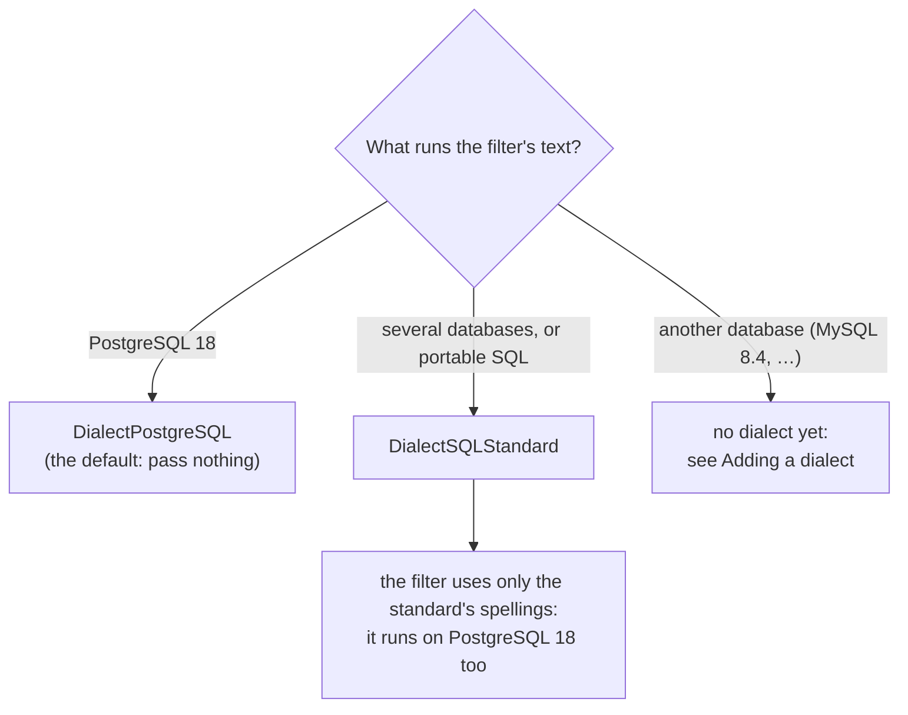
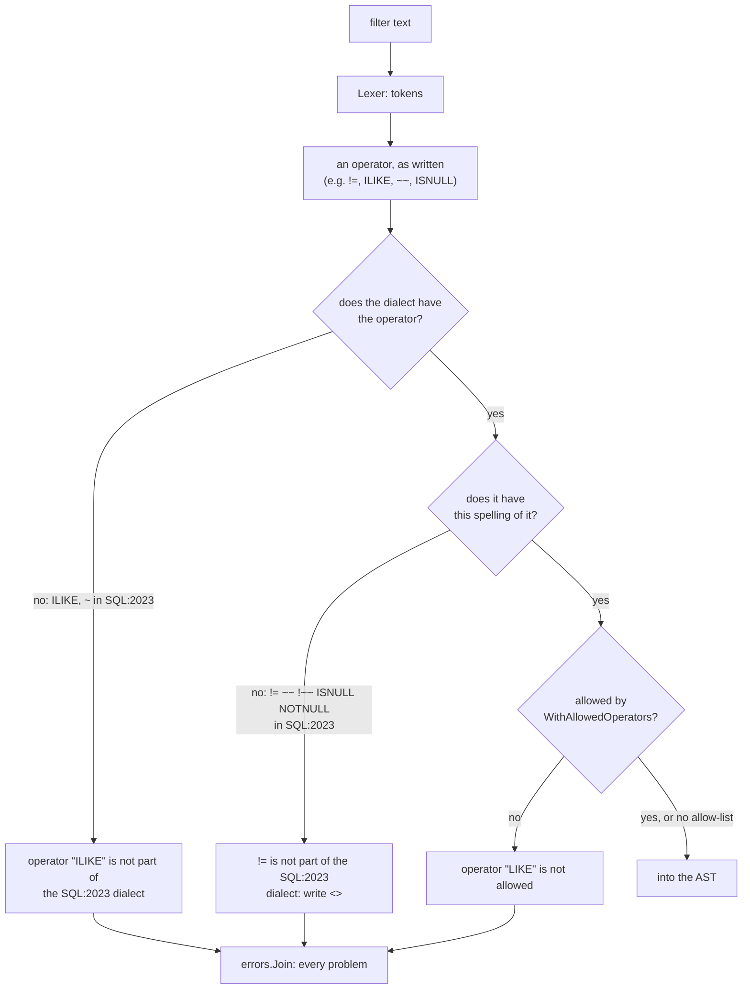

# SQL Dialects

A filter that the parser accepts is text you will run as SQL. The **dialect**
says which SQL: the parser accepts exactly what that database, or that
standard, accepts, and refuses the rest with a message that says what to
write instead.

| Dialect | Value | `String()` | Reference |
| --- | --- | --- | --- |
| PostgreSQL 18 (the default) | `qfv.DialectPostgreSQL` | `PostgreSQL 18` | PostgreSQL 18, and its manual's [SQL Syntax](https://www.postgresql.org/docs/18/sql-syntax.html) chapter |
| SQL:2023 | `qfv.DialectSQLStandard` | `SQL:2023` | ISO/IEC 9075:2023, Part 2 (Foundation), as PostgreSQL's [SQL Conformance](https://www.postgresql.org/docs/18/features-sql-standard.html) appendix names its features |

```go
// PostgreSQL 18: the default, no option needed.
p := qfv.NewFilterParser(fields)

// The SQL standard.
s := qfv.NewFilterParser(fields, qfv.WithDialect(qfv.DialectSQLStandard))
```

## Why a filter parser needs a dialect

The parser **checks** an expression; it does not **translate** one. The usual
way to use it is to validate the `filter` query parameter and then put that
same text in a `WHERE` clause. So "accepted" has to mean "the database runs
it", and every SQL accepts something different:

- `id != 1` runs on PostgreSQL 18 and is not SQL:2023, which writes `id <> 1`.
- `name ILIKE 'x%'` runs on PostgreSQL 18 and is not SQL:2023, which has no
  case-insensitive `LIKE`.
- `name LIKE 'x%' ESCAPE ''` runs on PostgreSQL 18; SQL:2023 disallows an
  empty escape.

When the parser and the database disagree, the best outcome is a database
error on a request the parser called valid. The worst is a filter the parser
read as one predicate and the database reads as another. The dialect is how
you tell the parser which database it is speaking for.

## Choosing a dialect



- **PostgreSQL 18** is the default and the grammar every version of this
  package has parsed. Use it when PostgreSQL runs the filter.
- **SQL:2023** accepts a subset of PostgreSQL 18's grammar: everything it
  accepts runs on PostgreSQL 18 as well. Use it when the filter must stay
  portable, or when you want clients to write the standard's spellings.
- Only these two exist. `Dialect` is a struct with unexported fields, so
  there is no way to name a dialect the package does not have. Its zero value
  is `DialectPostgreSQL`.

## How a filter is checked against it

The lexer turns the text into tokens. The parser then checks every field
against the allow-list, and every operator against the dialect, first as an
operator and then in the spelling it was written in. Only then does it check
the operator against the operator allow-list. Every problem is collected, and
`Parse` returns them joined.



### The dialect and the operator allow-list

The dialect says what the SQL has; `WithAllowedOperators` and
`WithAllowedOperatorGroups` say what you let clients use. An operator must
pass both, so the dialect always wins: allowing `OpILike` does not put
`ILIKE` in SQL:2023.


`Dialect.Operators()` returns the dialect's operators, for building an
allow-list or showing clients what they may write.

## What each dialect accepts

Every construct the filter parser knows, in each dialect. A ✅ is accepted
and a ❌ refused, with the spelling the dialect does have.

| Construct | PostgreSQL 18 | SQL:2023 | SQL:2023 feature |
| --- | --- | --- | --- |
| `=`, `<`, `<=`, `>`, `>=` | ✅ | ✅ | E061-01 |
| `<>` | ✅ | ✅ | E061-01 |
| `!=` | ✅ | ❌ write `<>` | — |
| `AND`, `OR`, `NOT`, `( … )` | ✅ | ✅ | — |
| `BETWEEN`, `NOT BETWEEN` | ✅ | ✅ | E061-02 |
| `BETWEEN SYMMETRIC`, `BETWEEN ASYMMETRIC` | ✅ | ✅ | T461 |
| `IN ( … )`, `NOT IN ( … )` | ✅ | ✅ | E061-03 |
| `LIKE`, `NOT LIKE` | ✅ | ✅ | E061-04 |
| `LIKE … ESCAPE 'c'` | ✅ | ✅ | E061-05 |
| `LIKE … ESCAPE ''` (escaping off) | ✅ | ❌ one character | — |
| `ILIKE`, `NOT ILIKE` | ✅ | ❌ no such predicate | — |
| `~~`, `!~~` | ✅ | ❌ write `LIKE`, `NOT LIKE` | — |
| `~~*`, `!~~*` | ✅ | ❌ no such predicate | — |
| `SIMILAR TO`, `NOT SIMILAR TO`, with `ESCAPE` | ✅ | ✅ | T141 |
| `~`, `~*`, `!~`, `!~*` | ✅ | ❌ the standard's is `LIKE_REGEX`, which the parser does not read | — |
| `IS NULL`, `IS NOT NULL` | ✅ | ✅ | E061-06 |
| `ISNULL`, `NOTNULL` | ✅ | ❌ write `IS NULL`, `IS NOT NULL` | — |
| `IS [NOT] TRUE`, `FALSE`, `UNKNOWN` | ✅ | ✅ | F571 |
| `IS [NOT] DISTINCT FROM` | ✅ | ✅ | T151, T152 |
| string, number and boolean literals | ✅ | ✅ | — |

Where the ❌ comes from: PostgreSQL's own manual calls each of these its own.
`<>` is "the standard SQL notation for not equal", and `!=` is an alias.
`ILIKE` is "not in the SQL standard but is a PostgreSQL extension". The `~~`
operators "are PostgreSQL-specific". `ISNULL` and `NOTNULL` are "nonstandard
syntax". "A zero-length ESCAPE value is disallowed" by the standard.

## What the refusals say

The SQL:2023 dialect's refusals, as `Parse` writes them:

| Input | Error |
| --- | --- |
| `id != 1` | `!= is not part of the SQL:2023 dialect: write <>` |
| `name ~~ 'x%'` | `~~ is not part of the SQL:2023 dialect: write LIKE` |
| `name !~~ 'x%'` | `!~~ is not part of the SQL:2023 dialect: write NOT LIKE` |
| `name ISNULL` | `ISNULL is not part of the SQL:2023 dialect: write IS NULL` |
| `name NOTNULL` | `NOTNULL is not part of the SQL:2023 dialect: write IS NOT NULL` |
| `name ILIKE 'x%'`, `name ~~* 'x%'` | `operator "ILIKE" is not part of the SQL:2023 dialect` |
| `name ~ '^x'` | `operator "~" is not part of the SQL:2023 dialect` |
| `name LIKE 'x%' ESCAPE ''` | `an empty ESCAPE is not part of the SQL:2023 dialect: the escape character is one character` |

Each is a `*qfv.QFVFilterError`, joined with any other problem in the same
filter (see [Error Handling](error-handling.md)).

## What a dialect does not do

- **It does not translate.** A filter written for PostgreSQL 18 is not
  rewritten for another database. Choose the dialect of the database that
  runs it.
- **It does not know your columns.** Types are the database's: `id = 'x'` is
  accepted in both dialects and fails on an integer column. Whether `LIKE`
  is case-sensitive depends on the column's collation.
- **It does not change what a pattern means.** Without `ESCAPE`, PostgreSQL
  18's escape character is the backslash, and SQL:2023 has none, so
  `name LIKE '100\%'` matches `100%` on PostgreSQL 18, and `100\` followed
  by anything under the standard. The parser cannot see which you
  meant, so write an `ESCAPE` clause when it matters.
- **It does not apply to sorting or field selection.** The sort parser reads
  `field [ASC|DESC]` and the fields parser reads a list of names. Both are the
  same in every SQL, so they take no dialect.

## Adding a dialect

A dialect is a set of operators and spellings, and sometimes lexing rules,
checked against the database it names. The next one planned is **MySQL
8.4** ([reference](https://dev.mysql.com/doc/refman/8.4/en/sql-statements.html)),
and it shows what a dialect can take:

- **Operators it lacks:** `ILIKE`, `SIMILAR TO`, the `~` and `~~` families,
  `ISNULL`/`NOTNULL` as postfix operators, `BETWEEN SYMMETRIC`,
  `IS DISTINCT FROM`.
- **Operators it adds:** `<=>` (null-safe equality) and `REGEXP`/`RLIKE`,
  which need new tokens and nodes.
- **Lexing rules:** MySQL reads a backslash inside a string as an escape by
  default. The lexer must read strings the way MySQL does, or the parser and
  the database could read the same text as different predicates.
- **Tests run against the database:** every accepted and refused row checked
  against a running MySQL 8.4, as PostgreSQL 18's are.
