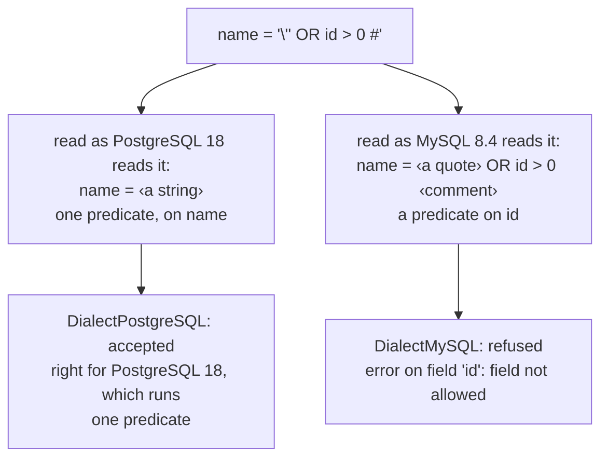
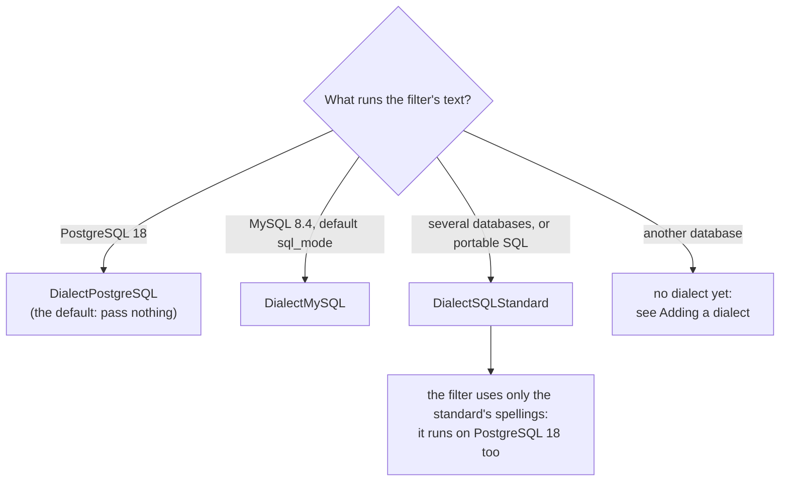
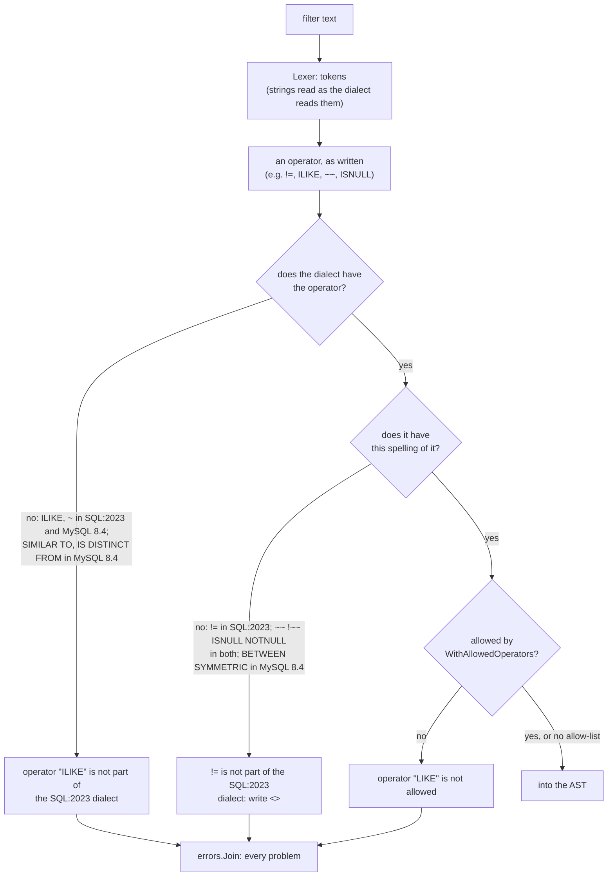
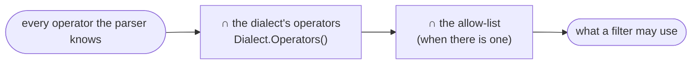

# SQL Dialects

A filter that the parser accepts is text you will run as SQL. The **dialect**
says which SQL: the parser accepts exactly what that database, or that
standard, accepts, and refuses the rest with a message that says what to
write instead.

| Dialect | Value | `String()` | Reference |
| --- | --- | --- | --- |
| PostgreSQL 18 (the default) | `qfv.DialectPostgreSQL` | `PostgreSQL 18` | PostgreSQL 18, and its manual's [SQL Syntax](https://www.postgresql.org/docs/18/sql-syntax.html) chapter |
| SQL:2023 | `qfv.DialectSQLStandard` | `SQL:2023` | ISO/IEC 9075:2023, Part 2 (Foundation), as PostgreSQL's [SQL Conformance](https://www.postgresql.org/docs/18/features-sql-standard.html) appendix names its features |
| MySQL 8.4 | `qfv.DialectMySQL` | `MySQL 8.4` | MySQL 8.4 with its default `sql_mode`, and its manual's [SQL Statements](https://dev.mysql.com/doc/refman/8.4/en/sql-statements.html) |

```go
// PostgreSQL 18: the default, no option needed.
p := qfv.NewFilterParser(fields)

// The SQL standard.
s := qfv.NewFilterParser(fields, qfv.WithDialect(qfv.DialectSQLStandard))

// MySQL 8.4.
m := qfv.NewFilterParser(fields, qfv.WithDialect(qfv.DialectMySQL))
```

## Why a filter parser needs a dialect

The parser **checks** an expression; it does not **translate** one. The usual
way to use it is to validate the `filter` query parameter and then put that
same text in a `WHERE` clause. So "accepted" has to mean "the database runs
it", and every SQL accepts something different:

- `id != 1` runs on PostgreSQL 18 and MySQL 8.4, and is not SQL:2023, which
  writes `id <> 1`.
- `name ILIKE 'x%'` runs on PostgreSQL 18, and on neither of the others.
- `name = 'a\'b'` is one string, `a'b`, to MySQL 8.4, and to PostgreSQL 18 the
  string `a\` followed by `b'`.

When the parser and the database disagree, the best outcome is a database
error on a request the parser called valid. The worst is a filter the parser
read as one predicate and the database reads as another, and the next section
shows one. The dialect is how you tell the parser which database it is
speaking for.

## A string is read the way the database reads it

MySQL 8.4 reads a backslash inside a string as an escape: `\'` is a quote that
does not end the string. PostgreSQL 18 and the SQL standard read it as a
character. A parser that reads strings one way, in front of a database that
reads them the other, can be shown a filter whose predicates it never sees.

With the field allow-list `["name"]`, PostgreSQL's reading of this filter is
one comparison of `name` with a string:

```text
name = '\'' OR id > 0 #'
```

MySQL 8.4 runs the same text, followed by a newline as in a SQL template, as a
comparison of `name` with a single quote, then `id > 0`, then a comment to the
end of the line. It returns every row, filtered on `id`, a field the allow-list
does not have.



`DialectMySQL` reads strings as MySQL 8.4 does, so it sees `id` and refuses
it. Before `v1.2.0` there was no MySQL dialect: a parser in front of MySQL read
strings as PostgreSQL does, and accepted that filter.

MySQL's `sql_mode` can turn backslash escapes off (`NO_BACKSLASH_ESCAPES`). The
parser cannot see the server's mode: `DialectMySQL` is MySQL 8.4's default,
which has them on.

## Choosing a dialect



- **PostgreSQL 18** is the default and the grammar every version of this
  package has parsed. Use it when PostgreSQL runs the filter.
- **MySQL 8.4** is PostgreSQL's grammar without what MySQL does not run, with
  strings read as MySQL reads them. Use it when MySQL runs the filter. It is
  not optional there: see the section above.
- **SQL:2023** accepts a subset of PostgreSQL 18's grammar, and everything it
  accepts runs on PostgreSQL 18 as well. Use it when the filter must stay
  portable, or when you want clients to write the standard's spellings.
- Only these three exist. `Dialect` is a struct with unexported fields, so
  there is no way to name a dialect the package does not have. Its zero value
  is `DialectPostgreSQL`.

## How a filter is checked against it

The lexer turns the text into tokens, reading strings as the dialect does. The
parser then checks every field against the allow-list, and every operator
against the dialect, first as an operator and then in the spelling it was
written in. Only then does it check the operator against the operator
allow-list. Every problem is collected, and `Parse` returns them joined.



### The dialect and the operator allow-list

The dialect says what the SQL has; `WithAllowedOperators` and
`WithAllowedOperatorGroups` say what you let clients use. An operator must
pass both, so the dialect always wins: allowing `OpILike` does not put
`ILIKE` in SQL:2023 or MySQL 8.4.



`Dialect.Operators()` returns the dialect's operators, for building an
allow-list or showing clients what they may write.

## What each dialect accepts

Every construct the filter parser knows, in each dialect. A ✅ is accepted
and a ❌ refused, with the spelling the dialect does have. The MySQL 8.4 column
was run against MySQL 8.4.13 with its default `sql_mode`.

| Construct | PostgreSQL 18 | SQL:2023 | SQL:2023 feature | MySQL 8.4 |
| --- | --- | --- | --- | --- |
| `=`, `<`, `<=`, `>`, `>=` | ✅ | ✅ | E061-01 | ✅ |
| `<>` | ✅ | ✅ | E061-01 | ✅ |
| `!=` | ✅ | ❌ write `<>` | — | ✅ |
| `AND`, `OR`, `NOT`, `( … )` | ✅ | ✅ | — | ✅ |
| `BETWEEN`, `NOT BETWEEN` | ✅ | ✅ | E061-02 | ✅ |
| `BETWEEN SYMMETRIC`, `BETWEEN ASYMMETRIC` | ✅ | ✅ | T461 | ❌ write `BETWEEN` |
| `IN ( … )`, `NOT IN ( … )` | ✅ | ✅ | E061-03 | ✅ |
| `LIKE`, `NOT LIKE` | ✅ | ✅ | E061-04 | ✅ |
| `LIKE … ESCAPE 'c'` | ✅ | ✅ | E061-05 | ✅ |
| `LIKE … ESCAPE ''` (escaping off) | ✅ | ❌ one character | — | ✅ |
| `ILIKE`, `NOT ILIKE` | ✅ | ❌ no such predicate | — | ❌ no such predicate |
| `~~`, `!~~` | ✅ | ❌ write `LIKE`, `NOT LIKE` | — | ❌ write `LIKE`, `NOT LIKE` |
| `~~*`, `!~~*` | ✅ | ❌ no such predicate | — | ❌ no such predicate |
| `SIMILAR TO`, `NOT SIMILAR TO`, with `ESCAPE` | ✅ | ✅ | T141 | ❌ no such predicate |
| `~`, `~*`, `!~`, `!~*` | ✅ | ❌ the standard's is `LIKE_REGEX` | — | ❌ MySQL's is `REGEXP` |
| `IS NULL`, `IS NOT NULL` | ✅ | ✅ | E061-06 | ✅ |
| `ISNULL`, `NOTNULL` | ✅ | ❌ write `IS NULL`, `IS NOT NULL` | — | ❌ write `IS NULL`, `IS NOT NULL` |
| `IS [NOT] TRUE`, `FALSE`, `UNKNOWN` | ✅ | ✅ | F571 | ✅ |
| `IS [NOT] DISTINCT FROM` | ✅ | ✅ | T151, T152 | ❌ MySQL's is `<=>` |
| string, number and boolean literals | ✅ | ✅ | — | ✅, strings read with backslash escapes |

`LIKE_REGEX`, `REGEXP` and `<=>` are not part of this package's grammar, in
any dialect.

Where the ❌ comes from:

- **SQL:2023:** PostgreSQL's own manual calls each of these its own. `<>` is
  "the standard SQL notation for not equal", and `!=` is an alias. `ILIKE` is
  "not in the SQL standard but is a PostgreSQL extension". The `~~` operators
  "are PostgreSQL-specific". `ISNULL` and `NOTNULL` are "nonstandard syntax".
  "A zero-length ESCAPE value is disallowed" by the standard.
- **MySQL 8.4:** each one was run against MySQL 8.4.13, and each is a syntax
  error there except an escape of two characters (`Incorrect arguments to
  ESCAPE`).

## What the refusals say

The refusals, as `Parse` writes them. Each is a `*qfv.QFVFilterError`, joined
with any other problem in the same filter (see
[Error Handling](error-handling.md)).

### SQL:2023

| Input | Error |
| --- | --- |
| `id != 1` | `!= is not part of the SQL:2023 dialect: write <>` |
| `name ~~ 'x%'` | `~~ is not part of the SQL:2023 dialect: write LIKE` |
| `name !~~ 'x%'` | `!~~ is not part of the SQL:2023 dialect: write NOT LIKE` |
| `name ISNULL` | `ISNULL is not part of the SQL:2023 dialect: write IS NULL` |
| `name NOTNULL` | `NOTNULL is not part of the SQL:2023 dialect: write IS NOT NULL` |
| `name ILIKE 'x%'`, `name ~~* 'x%'` | `operator "ILIKE" is not part of the SQL:2023 dialect` |
| `name ~ '^x'` | `operator "~" is not part of the SQL:2023 dialect` |
| `name LIKE 'x%' ESCAPE ''` | `an empty ESCAPE is not part of the SQL:2023 dialect: the escape character is one character` |

### MySQL 8.4

| Input | Error |
| --- | --- |
| `name ~~ 'x%'` | `~~ is not part of the MySQL 8.4 dialect: write LIKE` |
| `name !~~ 'x%'` | `!~~ is not part of the MySQL 8.4 dialect: write NOT LIKE` |
| `name ISNULL` | `ISNULL is not part of the MySQL 8.4 dialect: write IS NULL` |
| `name NOTNULL` | `NOTNULL is not part of the MySQL 8.4 dialect: write IS NOT NULL` |
| `id BETWEEN SYMMETRIC 2 AND 1` | `BETWEEN SYMMETRIC is not part of the MySQL 8.4 dialect: write BETWEEN, the lower bound first` |
| `id BETWEEN ASYMMETRIC 1 AND 2` | `BETWEEN ASYMMETRIC is not part of the MySQL 8.4 dialect: write BETWEEN` |
| `name ILIKE 'x%'`, `name ~~* 'x%'` | `operator "ILIKE" is not part of the MySQL 8.4 dialect` |
| `name SIMILAR TO 'x%'` | `operator "SIMILAR TO" is not part of the MySQL 8.4 dialect` |
| `name ~ '^x'` | `operator "~" is not part of the MySQL 8.4 dialect` |
| `id IS DISTINCT FROM 1` | `operator "IS DISTINCT FROM" is not part of the MySQL 8.4 dialect` |
| `name = '\'' OR id > 0 #'` | `error on field 'id': field not allowed` (with the allow-list `["name"]`) |

## What a dialect does not do

- **It does not translate.** A filter written for one database is not
  rewritten for another. Choose the dialect of the database that runs it.
- **It does not know your columns.** Types are the database's: `id = 'x'` is
  accepted in every dialect and fails on an integer column in PostgreSQL.
  Whether `LIKE` is case-sensitive depends on the column's collation.
- **It does not see the server's settings.** `DialectMySQL` is MySQL 8.4's
  default `sql_mode`. A server with `NO_BACKSLASH_ESCAPES` reads strings as
  PostgreSQL does, and `ANSI_QUOTES` or `PIPES_AS_CONCAT` change the grammar
  further.
- **It does not change what a pattern means.** Without `ESCAPE`, PostgreSQL
  18's and MySQL 8.4's escape character is the backslash, and SQL:2023 has
  none, so `name LIKE '100\%'` matches `100%` on PostgreSQL 18 and MySQL 8.4,
  and `100\` followed by anything under the standard. The parser cannot see
  which you meant, so write an `ESCAPE` clause when it matters.
- **It is stricter than the database in places, never looser.** MySQL 8.4
  takes `ESCAPE 1` and strings in double quotes. The parser refuses both,
  in every dialect.
- **It does not apply to sorting or field selection.** The sort parser reads
  `field [ASC|DESC]` and the fields parser reads a list of names. Both are the
  same in every SQL, so they take no dialect.

## Adding a dialect

A dialect is a set of operators and spellings, and sometimes rules for reading
strings, each checked against the database it names, with every accepted and
refused row run against it. MySQL 8.4 shows what one can take:

- **Operators it lacks**, refused as the database refuses them.
- **Spellings it lacks**, refused with the one it has.
- **How it reads strings.** MySQL's backslash escapes made the lexer take the
  dialect, since reading strings the wrong way lets a predicate past the
  allow-list.

What MySQL 8.4 has and this package does not parse yet: `<=>` (null-safe
equality) and `REGEXP`/`RLIKE`. Each would be a new operator and a new node,
and so a minor version of its own.
